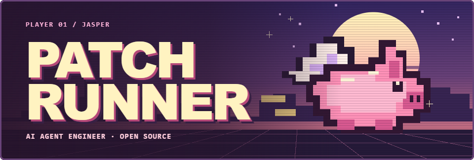
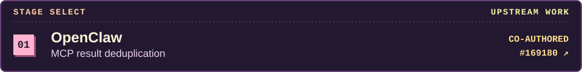

  <picture>
    <source media="(max-width: 600px) and (prefers-reduced-motion: reduce)" srcset="https://raw.githubusercontent.com/jipeng6036-del/jipeng6036-del/main/assets/patch-runner/hero-mobile.svg">
    <source media="(prefers-reduced-motion: reduce)" srcset="https://raw.githubusercontent.com/jipeng6036-del/jipeng6036-del/main/assets/patch-runner/hero.svg">
    <source media="(max-width: 600px)" srcset="https://raw.githubusercontent.com/jipeng6036-del/jipeng6036-del/main/assets/patch-runner/hero-mobile.webp">
    
  </picture> 
  <a href="https://github.com/openclaw/openclaw/pull/169180"><picture>
    <source media="(max-width: 600px)" srcset="https://raw.githubusercontent.com/jipeng6036-del/jipeng6036-del/main/assets/patch-runner/openclaw-mobile.svg">
    
  </picture></a> 
  <a href="https://github.com/langgenius/dify/pull/45586"><picture>
    <source media="(max-width: 600px)" srcset="https://raw.githubusercontent.com/jipeng6036-del/jipeng6036-del/main/assets/patch-runner/dify-mobile.svg">
    
  </picture></a>

I build **AI agents** and contribute fixes upstream across MCP, retrieval, document processing, and workflow runtimes.

**[Merged PRs](https://github.com/search?q=is%3Apr+is%3Amerged+author%3Ajipeng6036-del&type=pullrequests)** · [Open PRs](https://github.com/search?q=is%3Apr+is%3Aopen+author%3Ajipeng6036-del&type=pullrequests) · [OpenClaw commit credit](https://github.com/openclaw/openclaw/commit/5270b0374a53ed3eb93903fe3510ee2e7cc3f8bc)

<strong>More merged work</strong>

- **Docling** · Preserve currency, percentage, and date formats in Excel conversion. [#4628](https://github.com/docling-project/docling/pull/4628)
- **nanobot** · Normalize WhatsApp timestamps before replay filtering. [#6127](https://github.com/HKUDS/nanobot/pull/6127)
- **DeepSeek-Reasonix** · Return an empty sessions list for folders without conversations. [#12744](https://github.com/esengine/DeepSeek-Reasonix/pull/12744)
- **AgentScope** · Handle embedding responses that omit usage data. [#3199](https://github.com/agentscope-ai/agentscope/pull/3199)
- **Koa** · Normalize the forwarded protocol before checking whether a request is secure. [#2029](https://github.com/koajs/koa/pull/2029)
- **Poetry** · Validate distributions against the hashes for each file in the lockfile. [#11131](https://github.com/python-poetry/poetry/pull/11131)
- **OpenWiki** · Fix in-page links to page names with non-ASCII characters. [#1070](https://github.com/langchain-ai/openwiki/pull/1070)
- **OpenJarvis** · Preserve OAuth URL parameters when opening the browser on Windows. [#1168](https://github.com/open-jarvis/OpenJarvis/pull/1168)

