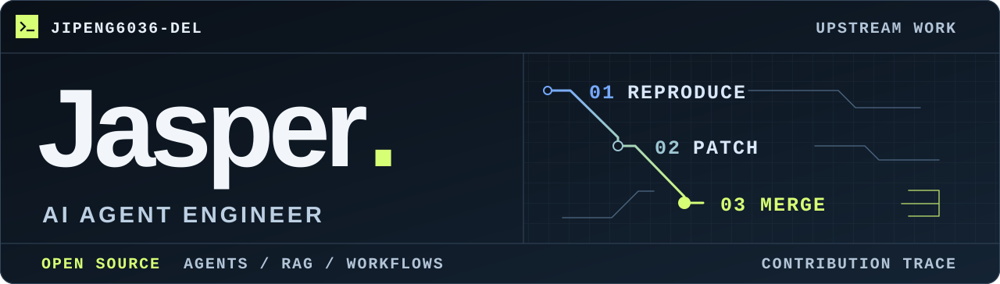

I build **AI agents** and contribute to the tools they run on, from MCP and retrieval to document processing and workflow runtimes.

**[Merged pull requests](https://github.com/search?q=is%3Apr+is%3Amerged+author%3Ajipeng6036-del&type=pullrequests)** · [Open pull requests](https://github.com/search?q=is%3Apr+is%3Aopen+author%3Ajipeng6036-del&type=pullrequests)

## Upstream highlights

**OpenClaw** · `CO-AUTHOR` 
Removed duplicate MCP tool results when servers echo structured output as JSON. [Merged PR #169180](https://github.com/openclaw/openclaw/pull/169180) · [Commit credit](https://github.com/openclaw/openclaw/commit/5270b0374a53ed3eb93903fe3510ee2e7cc3f8bc)

**Dify** · `MERGED` 
Scoped Qdrant deletions by document ID to the active dataset. [PR #45586](https://github.com/langgenius/dify/pull/45586)

## More merged work

- **Docling** · Preserve currency, percentage, and date formats in Excel conversion. [#4628](https://github.com/docling-project/docling/pull/4628)
- **nanobot** · Normalize WhatsApp timestamps before replay filtering. [#6127](https://github.com/HKUDS/nanobot/pull/6127)
- **DeepSeek-Reasonix** · Return an empty sessions list for folders without conversations. [#12744](https://github.com/esengine/DeepSeek-Reasonix/pull/12744)
- **AgentScope** · Handle embedding responses that omit usage data. [#3199](https://github.com/agentscope-ai/agentscope/pull/3199)

More from Koa, Poetry, OpenWiki, and OpenJarvis

- **Koa** · Normalize the forwarded protocol before checking whether a request is secure. [#2029](https://github.com/koajs/koa/pull/2029)
- **Poetry** · Validate distributions against the hashes for each file in the lockfile. [#11131](https://github.com/python-poetry/poetry/pull/11131)
- **OpenWiki** · Fix in-page links to page names with non-ASCII characters. [#1070](https://github.com/langchain-ai/openwiki/pull/1070)
- **OpenJarvis** · Preserve OAuth URL parameters when opening the browser on Windows. [#1168](https://github.com/open-jarvis/OpenJarvis/pull/1168)

