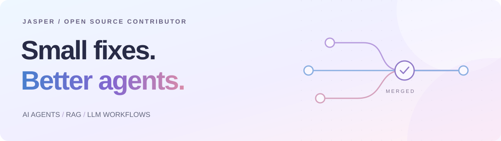

  

I’m **Jasper**, an AI Agent developer contributing to the tools we build with.
My focus is **agents, RAG, and LLM workflows** — following real bugs from reproduction to a tested fix.

  <a href="https://github.com/pulls?q=is%3Apr+author%3Ajipeng6036-del+is%3Amerged"><strong>Merged contributions ↗</strong></a>
  &nbsp; · &nbsp;
  <a href="https://github.com/pulls?q=is%3Apr+author%3Ajipeng6036-del+is%3Aopen">In progress ↗</a>

### A few contributions I’m glad to have made

| Project | What I helped improve | Merged PR |
| :--- | :--- | :--- |
| **[nanobot](https://github.com/HKUDS/nanobot)** | Normalize WhatsApp timestamps before replay filtering. | [#6127 ↗](https://github.com/HKUDS/nanobot/pull/6127) |
| **[AgentScope](https://github.com/agentscope-ai/agentscope)** | Handle OpenAI embedding responses with missing usage data. | [#3199 ↗](https://github.com/agentscope-ai/agentscope/pull/3199) |
| **[Serena](https://github.com/oraios/serena)** | Recover Erlang file reads while the language server loads. | [#2142 ↗](https://github.com/oraios/serena/pull/2142) |
| **[LiveKit Agents](https://github.com/livekit/agents)** | Treat exhausted OpenAI credit as a fatal realtime error. | [#7819 ↗](https://github.com/livekit/agents/pull/7819) |
| **[Xinference](https://github.com/xorbitsai/inference)** | Preserve all GLM-5 tool calls and text during streaming. | [#5689 ↗](https://github.com/xorbitsai/inference/pull/5689) |
| **[AMD GAIA](https://github.com/amd/gaia)** | Reindex watched Office documents after saves. | [#5729 ↗](https://github.com/amd/gaia/pull/5729) |

### Where my curiosity goes

**Agent workflows** &nbsp; / &nbsp; **Retrieval & memory** &nbsp; / &nbsp; **Developer tools**

Currently exploring LangGraph, Deep Agents, Pi Agent SDK, and LLM Wiki.

---

One reproducible bug. One thoughtful fix. A little better for everyone.

